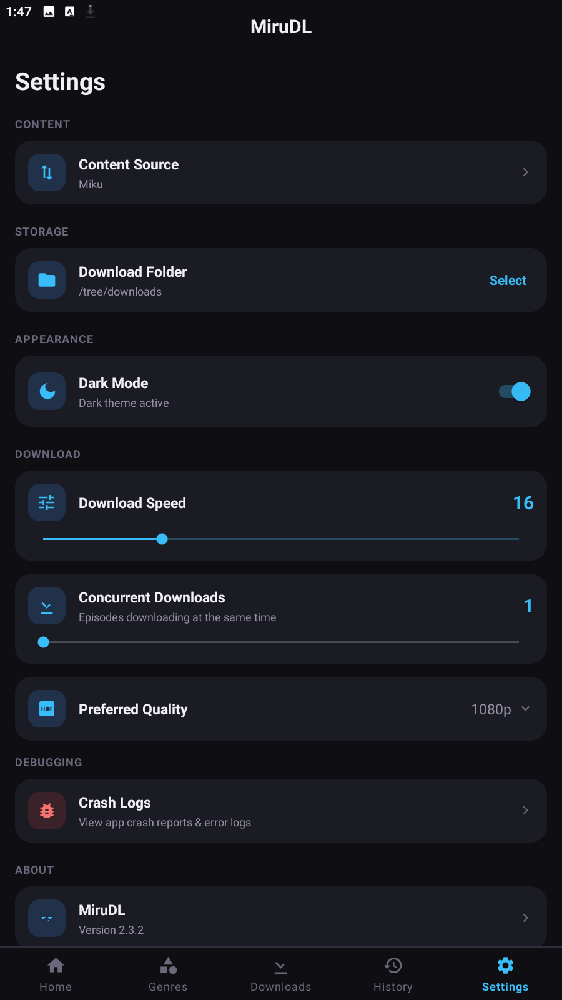
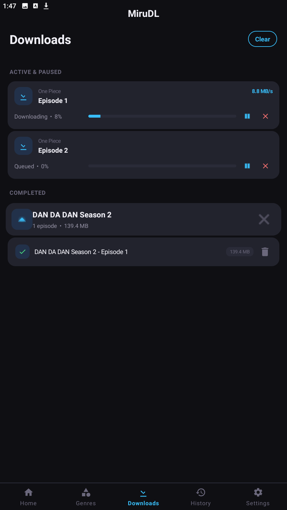
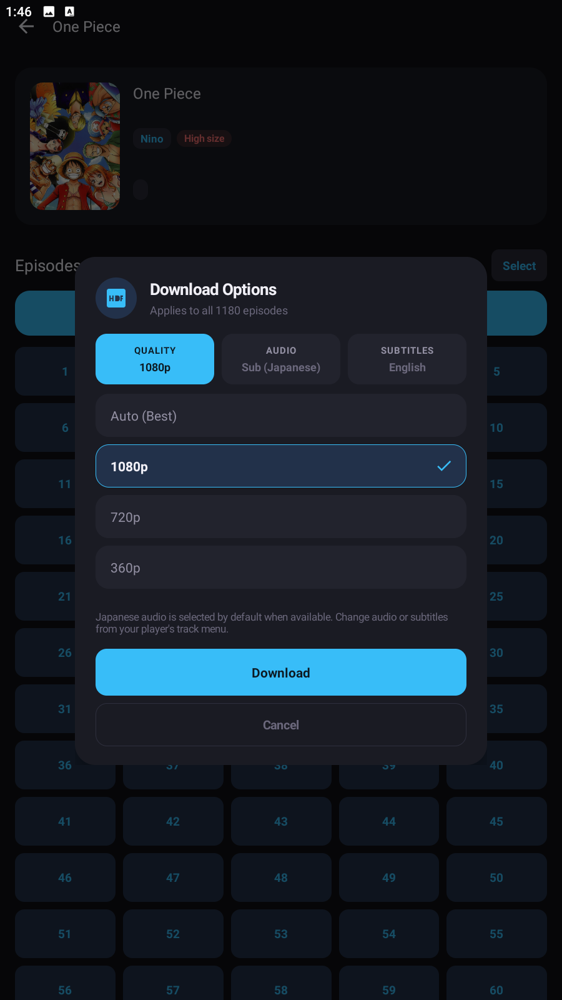
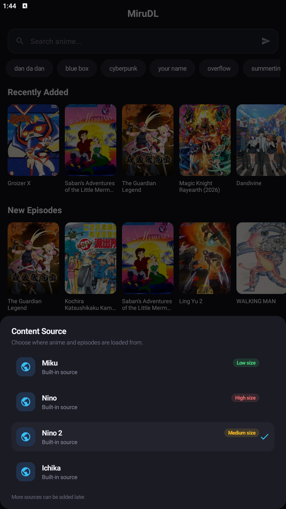

<h1>MiruDL</h1>

<strong>A lightweight Android app for browsing and downloading anime episodes.</strong>

No ads. No accounts. No sign-up.

  
  
  
  

 

<a href="https://mirudl.pages.dev">Website</a> &nbsp;·&nbsp;
<a href="https://github.com/msrofficial/MiruDL">GitHub</a> &nbsp;·&nbsp;
<a href="https://github.com/msrofficial/MiruDL/issues">Report an issue</a>

---

MiruDL is a lightweight, no-fuss Android app for browsing and downloading anime episodes. It brings search, episode browsing, quality selection, batch downloads, and a complete download manager into one clean Material 3 interface.

The app is built around a built-in HLS engine with support for multiple sources, separate audio and subtitle tracks, download speed control, and Android's Storage Access Framework for choosing exactly where files are saved.

> MiruDL does not host or distribute anime content. It only downloads streams from third-party sources. Users are responsible for complying with local laws and the terms of the services they use. MiruDL is not affiliated with any streaming platform.

## Features

| Feature | Description |
| --- | --- |
| **Search & episode browser** | Find titles quickly and browse episodes with season grouping and filler flags. |
| **Multiple sources** | Switch between supported anime sources from the app. |
| **Quality selection** | Choose a video quality before downloading, with automatic resolution detection. |
| **Sub & dub audio** | Pick the available audio track, including Japanese and English options. |
| **Separate subtitles** | Select subtitle tracks when the source provides them. |
| **Batch downloads** | Queue multiple episodes and let MiruDL handle the rest. |
| **Download manager** | Pause, resume, cancel, and retry downloads with live progress and notifications. |
| **Speed control** | Adjust download speed to match your connection. |
| **Custom folder** | Choose the destination folder through Android's Storage Access Framework. |
| **HLS engine** | Built-in stream downloader with segment retries and automatic muxing. |
| **Download history** | Keep completed downloads organized with their metadata. |
| **Dark & light mode** | Follows the system theme with a clean Material 3 interface. |

## Screenshots

| Home | Detail | Downloads | Settings |
| --- | --- | --- | --- |
|  |  |  |  |

## Installation

1. Open [mirudl.pages.dev](https://mirudl.pages.dev/#download) and download the latest APK.
2. Open the downloaded APK on your Android device.
3. If prompted, allow installs from your browser or file manager.
4. Launch MiruDL and choose a download folder.

**Requires Android 5.0 (API 21) or newer.**

---

